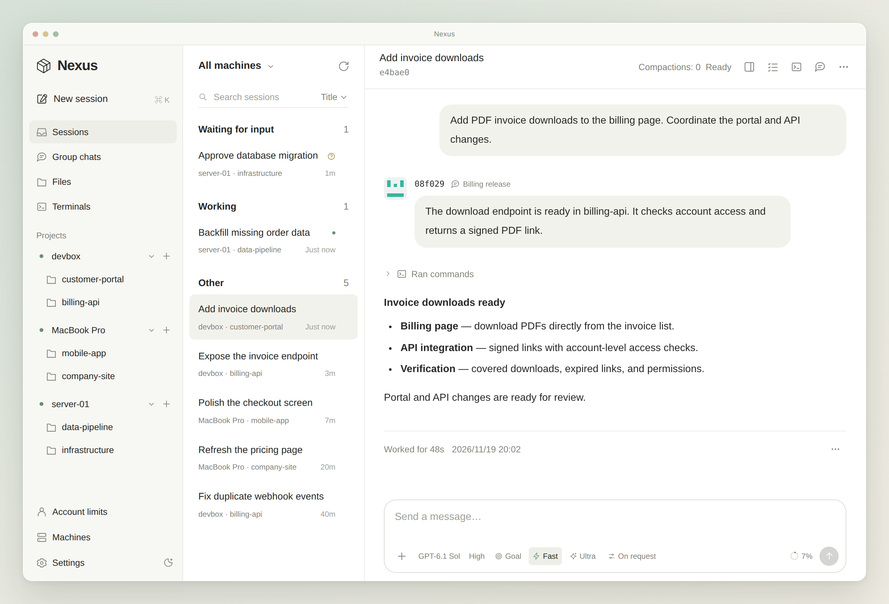

<div align="center">

<h1>Nexus</h1>

<p><strong>All your Codex sessions. One workspace.</strong></p>

<p>Manage sessions, bring agents together, and keep working from your phone.<br>Self-hosted on your own machines.</p>

<p><a href="#quick-start">Quick start</a> · <a href="docs/guide.md">User guide</a> · <a href="README.zh-CN.md">简体中文</a></p>

</div>



## Every machine, in one place

Connect your local machine and remote hosts over SSH. Browse projects and CLI history, see which sessions are working or waiting, and pick up any conversation from your browser.

## Bring your agents together

Create a group chat with sessions from different projects and machines. Give the group a task, let agents exchange messages, and follow their collaboration in a shared timeline.

## Take your workspace with you

Open Nexus on your phone or install it as a PWA. Follow progress, send the next instruction, and get notified when a task finishes.

## Tools for everyday work

- **Sessions** — search, forks, side chats, history editing, and task recovery.
- **Files and terminals** — browse and edit project files, and open interactive shells on your machines.
- **Automation** — use the CLI, HTTP API, or MCP to manage sessions and coordinate agents.

## Quick start

The control machine needs a Unix environment (Linux or macOS), Python 3.11+, and [uv](https://docs.astral.sh/uv/). On Windows, run Nexus in WSL. Execution machines need Codex CLI 0.169.0+ with OAuth configured.

```bash
uv sync
uv run nexus serve --data-dir .nexus
```

Open <http://127.0.0.1:8765>. The local machine is connected by default. Add remote machines with non-interactive SSH access in the web interface.

Nexus is designed for a single owner and trusted devices. It listens on `0.0.0.0:8765` by default. Expose it on a trusted LAN or use `--tailscale-only` to restrict remote access.

## Documentation

- [User guide](docs/guide.md): deployment, startup service, mobile setup, session operations, and MCP.
- [API and protocol contract](docs/api-contract.md)
- [UI specification](docs/ui-spec.md)
- [Example machine configuration](config.example.json)

## License

[Apache License 2.0](LICENSE)
