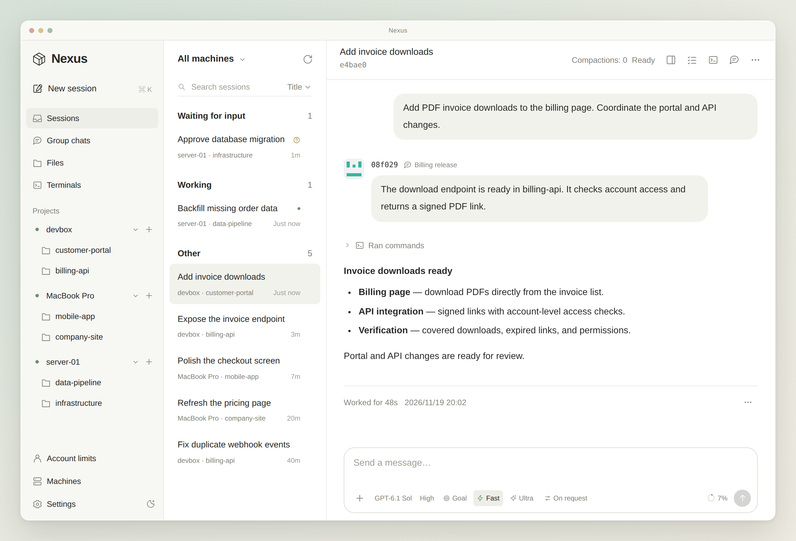

<div align="center">

<h1>Nexus</h1>

<p><strong>所有机器上的 Codex，一个工作台。</strong></p>

<p>集中管理会话，让 agent 协作，从电脑或手机接续工作。<br>自托管，运行在你自己的机器上。</p>

<p><a href="#快速开始">快速开始</a> · <a href="docs/guide.md">使用指南</a> · <a href="README.md">English</a></p>

</div>



## 多台机器，一处掌控

接入本机，通过 SSH 连接远端。在浏览器中浏览各台机器的项目和 CLI 历史，查看哪些会话正在工作、哪些等待回应，随时打开对话继续任务。

## 把 agent 拉进同一个群

将不同项目、不同机器上的会话加入群聊。向群里交代任务，让 agent 交换消息，在同一条时间线中查看协作进展。

## 离开电脑，也能接着做

在手机浏览器中打开 Nexus，或安装为 PWA。随时查看进展、发送下一条指令，任务完成后接收通知。

## 日常工作所需的工具

- **会话** — 搜索、分叉、侧聊、历史编辑与任务恢复。
- **文件与终端** — 浏览和编辑项目文件，在各台机器上打开交互终端。
- **自动化** — 通过 CLI、HTTP API 或 MCP 管理会话、协调 agent。

## 快速开始

控制机需要 Unix 环境（Linux 或 macOS）、Python 3.11+ 和 [uv](https://docs.astral.sh/uv/)。Windows 用户请在 WSL 中运行 Nexus。执行机器需要 Codex CLI 0.169.0+ 并配置 OAuth。

```bash
uv sync
uv run nexus serve --data-dir .nexus
```

打开 <http://127.0.0.1:8765>。默认接入本机，在“机器”中添加可免交互 SSH 登录的远端机器。

Nexus 面向单人和可信设备使用，默认监听 `0.0.0.0:8765`。请在可信局域网中开放，或使用 `--tailscale-only` 限制远程访问。

## 文档

- [使用指南](docs/guide.md)：部署、开机自启、手机安装、会话操作与 MCP 接入。
- [API 与协议](docs/api-contract.md)
- [UI 规范](docs/ui-spec.md)
- [机器配置示例](config.example.json)

## 许可证

[Apache License 2.0](LICENSE)
